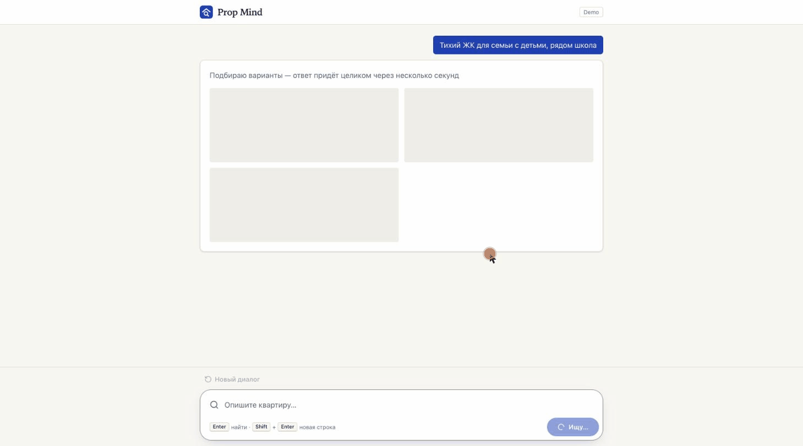
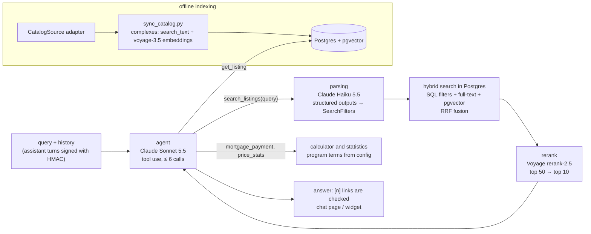

# prop-mind

**English** · [Русский](README.ru.md)

AI search for new-build apartments in Kazakhstan: describe the apartment in plain words — budget,
district, completion date, mountain view, quiet courtyard — and get matching residential complexes
with available apartments and a short explanation of why each one fits. The chat remembers the dialog
("what about the second one?"), calculates mortgage payments and shows price statistics by district.



**Demo:** https://79.76.99.122.sslip.io/chat (synthetic data: 70 complexes and 3,073 apartments in Almaty
and Astana; the interface is in Russian). Prices per m² follow a calibration table: city averages from
the Bureau of National Statistics, January 2026; district and class breakdown is an expert estimate,
November 2026 ([data/price_calibration.csv](data/price_calibration.csv)).

The database finds the listings; the LLM understands the request, calls tools and explains the result.
Every recommendation links to a real row in the database, and the links are checked against what was
found, so the model cannot invent an apartment.

## How it works



- **Agent.** The model decides which tool to call: find complexes, open the card of a complex from the
  previous answer, calculate a mortgage or median prices. It does not set rates or program limits —
  they come from the config; statistics are labelled "our catalog, not the market" and are not
  computed on fewer than five apartments.
- **Parsing.** The agent passes a plain-text query to search; a separate parser (Haiku) extracts the
  filters: city, districts, rooms, price, class, completion date, finishing, view, floor, payment
  options and a `semantic_query` for everything fields can't express ("quiet courtyard"). An impossible
  request ("near the metro in Astana" — there is none) gets a clarifying question instead of a search.
- **Search.** The semantic part describes the complex and is searched per complex: vector and
  full-text rankings are merged with Reciprocal Rank Fusion; hard filters apply to apartments. If
  nothing is found, soft filters are relaxed one by one and the answer says which. A cross-encoder
  reorders the top 50 and keeps 10.
- **Memory.** History comes from the client and is not stored on the server. The server signs its own
  turns: a forged or expired assistant turn is dropped, and complex ids from the history are rechecked
  against the database.
- **Answer.** The model can cite only complexes the tools returned in this turn; foreign numbers are
  removed. If nothing fully matches, the first sentence says so. Complex cards are shown next to the
  answer, so the text does not repeat them: up to three complexes, one sentence each.
- **Interface.** A React chat page (`/chat`) and a one-line `widget.js` that opens the same page in an
  iframe on an allowed site. Per-IP rate limit, daily model budget (the agent has its own share),
  public site keys, strict CSP. Rollback to the fixed v1 workflow (parse → search → rerank → answer) is
  `chat.mode: v1` in the config.

## Results

All numbers come from `evals/` (reports in `evals/results/`); methodology, intermediate measurements
and what did not work are in [docs/decisions.md](docs/decisions.md) (in Russian). The data is synthetic
and the sets are small — see "Limitations".

### Search: Recall@10 from 62% to 96%

11 dev queries where ranking matters (more than 10 complexes pass the filters, the semantic part
decides); full LLM labelling of every complex that passes the filters, reviewed by hand:

| Step | Recall@10 | MRR |
| --- | --- | --- |
| vectors over the whole query | 62% | 0.65 |
| + hybrid (RRF) | 73% | 0.76 |
| vectors over the semantic part | 66% | 0.73 |
| hybrid over the semantic part | 79% | 0.72 |
| **+ reranker `rerank-2.5`** | **96%** | **0.95** |

4 of the 11 queries have only 1–2 matching complexes.

### Query parsing

| What | Fully correct filters |
| --- | --- |
| parser, dev, 37 queries ×3 | 97% |
| parser, holdout, 8 queries (written by the author) ×3, two runs | 88% and 96% |
| agent: the query the agent passes to search → parser, dev 37 | **100%** |
| agent fills 22 filter fields itself (rejected) | 95% |
| same, optional fields (rejected) | 65% |

### Answer

- **No invented listings:** 0 out-of-list references — in 40 v1 answers (dev + holdout) and in 37 + 16
  agent answers.
- **Honest zero:** when nothing fully matches, the answer starts with "No full matches: …" — 2 of 2 for
  the agent (4 of 4 for v1); a false "no matches" while a match is shown — 4 of 13 for the agent (3 of 13
  for v1).
- **Answer model, blind review:** Sonnet 5.5 scored 4.9 of 5 vs 3.2 for Haiku 5.5, better in 9 of 10
  cases (graded by the author).
- **Agent features:** 12 of 12 dialogs — memory ("same in Astana", "what about the second one?"),
  mortgage (the payment in the answer matches the tool's calculation; a down payment below the minimum
  gets a reason, not a number), statistics, relaxation, clarification.

### Prompt injection

Red team: instructions in complex descriptions and in the query, keyword stuffing against the
reranker, and for the agent also forged dialog history (unsigned, tampered, expired turns, foreign ids).

| Set | Successful attacks |
| --- | --- |
| agent, dev | **0 of 55** |
| v1, dev / holdout (written by the author) | 0 of 43 / 0 of 11 (3 and 1 before the defenses) |

### Latency and cost (demo server, 10 full answers)

| | Full answer p50 / p95 | Cost per query |
| --- | --- | --- |
| **agent (v2)**, 2026-11-16 | **≈ 6.5 / 8.2 s** | **~$0.013** |
| agent before the speed-up, 2026-11-12 | 9.6 / 14.5 s | ~$0.044 |
| workflow (v1), 2026-11-09 | 6.3 / 8.0 s (first words 2.9 / 4.9 s) | ~$0.010 |

With 10 queries p95 is close to the maximum. The agent speed-up: plain-text search through the parser
instead of 22 fields, prompt caching, parsing and search in parallel with the first model call, a
shorter answer.

**v1 and v2 were not compared on the same cases for search and answer quality:** the chat moved to the
agent for product reasons — dialog memory and tools can't be expressed in v1; security, features, the
answer judge and latency were checked.

<details>
<summary>v1 on resale listings (tag <code>v0.3.0</code>)</summary>

The first version searched 1,048 resale listings. Search, 12 dev queries where ranking matters:

| Step | Variant | Recall@10 | MRR |
| --- | --- | --- | --- |
| 0 | vectors over the whole query | 43% | 0.70 |
| 1 | + hybrid (vectors + full-text, RRF) | 58% | 0.79 |
| 2 | vectors over the semantic part only | 54% | 0.80 |
| 3 | hybrid over the semantic part | 72% | 0.90 |
| 4 | **+ reranker `rerank-2.5`** | **98%** | **1.00** |

Parsing: dev 30 queries — 99% ± 2%, holdout 10 — 97% ± 6% (×3).

</details>

## Key decisions

- **A fixed workflow first, then an agent.** v1 (parse → search → rerank → answer) is cheap, predictable
  and measurable step by step — search, parsing and answers were tuned on it. The agent sits on top for
  what a workflow can't do: dialog memory and tools. The agent's search is the same v1 pipeline.
- **The agent writes a plain-text query, not 22 filter fields.** A tool call with 22 required fields
  cost ~600 output tokens and ~4.6 s, almost all of it serialization of empty fields; optional fields
  dropped parsing to 65%. Plain text + the v1 parser: first call 2.6 s, parsing 100%.
- **Parsing and search run in parallel with the first model call.** On the first turn the agent passes
  the user's message verbatim, so the search can start right away; the result is used only on an exact
  query match and is cancelled otherwise (used in 37 of 37 dev queries).
- **History without server state.** The client sends the history; the server signs its own turns (HMAC
  with a timestamp). No state and no personal data on the server, and assistant turns can't be forged.
- **Search by the semantic part of the query, not the whole text.** Filters already handle price and
  rooms; embedding "2-room under 40M with a quiet courtyard" mostly matches on the numbers. On resale
  listings this took vectors from 43% to 54% Recall@10 and hybrid from 58% to 72%.
- **RRF instead of score blending.** Vector and full-text scores live on different scales; rank-based
  fusion needs no weight tuning.
- **Contextual `search_text`.** Structured fields are prepended to the developer's description, so
  search sees what the description left out.
- **Structured outputs and strict tools.** The API enforces the schema, Pydantic validates it; `Literal`
  instead of `Enum` keeps the JSON schema flat; vocabularies come from the config.
- **Swappable provider, prompts as files.** Model names, limits and mortgage terms live in the config;
  prompts are files in `app/llm/prompts/`, so every change shows up in git next to its eval report.
- **Public demo safety.** Complex descriptions are data, not instructions (isolation in the prompt,
  escaping, contact stripping); per-IP rate limit, daily budget from `query_log`, site keys bound to
  domains (`frame-ancestors`), no inline scripts, personal data masked before logging.

## Limitations

- Synthetic data: 70 complexes and 3,073 apartments; complex descriptions were generated by Claude.
- Small eval sets: 37 dev + 8 holdout parsing queries, 11 queries with search labels, 12 agent dialogs
  (no holdout); a single grader in the blind review.
- v1 and v2 were not compared on the same cases for search and answer quality.
- The agent's answer arrives whole, not word by word: after tool results the API does not stream the
  response.
- The agent costs about 1.3× v1 (~$0.013 vs ~$0.010 per query).
- The per-IP limit lives in process memory — fine for one instance; several instances need Redis.
- Rare Voyage latency outliers (embeddings and rerank), up to tens of seconds; visible in `timings_ms`.

## Run locally

```bash
cp .env.example .env            # ANTHROPIC_API_KEY, VOYAGE_API_KEY, HISTORY_SECRET
docker compose up -d --build    # Postgres + pgvector, API on :8000 (Docker builds the chat page)
uv sync
uv run python scripts/migrate.py                                # tables for an existing database
uv run python scripts/sync_catalog.py --config config/demo.yaml # index complexes and apartments (< $0.01 Voyage)
curl localhost:8000/health      # "complexes": 70; chat: http://localhost:8000/chat
```

- `HISTORY_SECRET` is a random string: `python3 -c "import secrets; print(secrets.token_hex(32))"`.
- New synthetic data (optional, calls Claude):
  `uv run python scripts/generate_catalog.py --config config/demo.yaml`
- Tests: `uv run pytest`; chat page: `cd web/chat-app && npm ci && npm test && npm run typecheck`
- Evals: parsing `uv run python evals/run_evals.py --repeats 3` (by the agent — `--agent`); search and
  answer — `--layer search|answer|agent-answer`; agent cases `evals/run_agent_cases.py`; red team
  `evals/run_redteam.py [--mode v2]`
- Server deploy (Oracle Cloud Always Free, Caddy + HTTPS): [deploy/oracle/README.md](deploy/oracle/README.md)

## Repository

```text
app/            FastAPI, limits, query log
  llm/          agent (agent.py), parsing, v1 answer, provider client
  llm/prompts/  prompts as files
  search/       hybrid search, embeddings, rerank
  tools.py      mortgage calculator, price statistics, complex card
  history.py    signing and checking dialog history
  sources/      CatalogSource adapters (synthetic JSONL for the demo)
web/chat-app/   chat page: React + TypeScript + Vite + shadcn/ui
web/widget.js   button for third-party sites + popup with an iframe
evals/          cases, runners, reports in evals/results/
db/             schema and migrations
deploy/oracle/  server compose file and Caddy config
docs/           DESIGN.md (plan), decisions.md (what broke and why, numbers before/after; in Russian)
```

## License

[MIT](LICENSE). The data in `data/` is synthetic.
