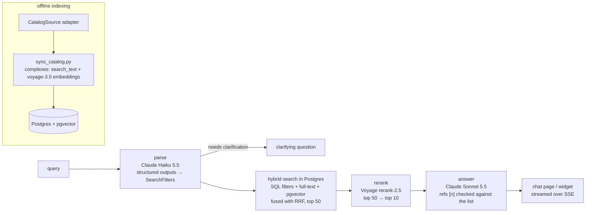

# prop-mind

**English** · [Русский](README.ru.md)

AI search for new-build apartments in Kazakhstan: describe the flat in plain words — budget, district,
completion date, a mountain view, a quiet courtyard — and get matching residential complexes with their
available apartments and a short explanation of why each one fits.

**Live demo:** https://79.76.99.122.sslip.io/chat (synthetic data: 70 residential complexes and 3,073
apartments in Almaty and Astana; the UI is in Russian). Prices per m² follow a calibration table:
city averages — Bureau of National Statistics (BNS), January 2026; the split by district and housing
class — expert estimate, November 2026 ([data/price_calibration.csv](data/price_calibration.csv)).

The database finds the listings; the LLM only understands the query and explains the result. Every
recommendation links to a real row, so the model cannot invent an apartment.

## How it works



- **Parse.** The query becomes a strict Pydantic `SearchFilters` object: city, deal type, rooms,
  price, districts, condition, features, plus a `semantic_query` for everything fields can't express
  ("quiet courtyard"). Impossible or vague requests ("metro in Astana" — there is none) return a
  clarifying question instead of a search.
- **Search.** Hard filters narrow the rows; vector and full-text rankings over the *semantic part*
  of the query are merged with Reciprocal Rank Fusion. If nothing matches, soft filters are relaxed
  one by one and the answer says which.
- **Rerank.** A cross-encoder reorders the top 50 and keeps 10.
- **Answer.** The model may cite only listings from the list; out-of-list references are stripped.
  If nothing fully fits, the first sentence says so explicitly ("no full matches: …").
- **UI.** A React chat page at `/chat` and a one-line `widget.js` that opens the same page in an
  iframe on any allowed site. Per-IP rate limit, daily model budget, public site keys, strict CSP.

## Results

All numbers come from `evals/run_evals.py`; methodology, every intermediate run and what didn't
work are in [docs/decisions.md](docs/decisions.md) (in Russian).

### New-build catalog (current demo)

The semantic part of a query («quiet», «for a family with kids») describes the complex, so it is
searched over complexes; hard filters (price, rooms, floor, view, windows, finishing, completion date,
payment options) apply to apartments. Results are grouped by complex and number of rooms.

Search, 11 dev queries where ranking matters (complete LLM labels over every complex that passes the
filters, reviewed by hand):

| Step | Recall@10 | MRR |
| --- | --- | --- |
| vectors over the whole query | 62% | 0.65 |
| + hybrid (RRF) | 73% | 0.76 |
| vectors over the semantic part | 66% | 0.73 |
| hybrid over the semantic part | 79% | 0.72 |
| **+ reranker `rerank-2.5`** | **96%** | **0.95** |

- **Parsing:** dev 97% fully correct (37 queries), holdout 92% (8 queries written by the author,
  two runs ×3: 88% and 96%).
- **Answer** (33 dev answers): 0 out-of-list references; honest zero 2 of 2; no false «no full
  matches» in 10 of 13; ~$0.016 per answer, first token p50 1.0 s.
- **Prompt injection:** 0 of 43 (dev) and 0 of 11 (holdout) red-team attacks succeed, including
  keyword stuffing against the reranker.

Caveats: 4 of the 11 queries have only 1–2 matching complexes; the data is synthetic.

### Agent (v2): tool use

The chat runs through an agent: the model calls search, complex card, mortgage calculator and price
statistics tools itself and remembers the dialog (history comes from the client; assistant turns are
signed by the server). **It was not compared with v1 on search or answer quality** — the switch is a
product decision ([decisions.md](docs/decisions.md#переход-на-v2-без-проверки-критерия-2026-11-12--2026-11-16), in Russian). Checked:

- **Prompt injection:** 0 of 55 dev attacks succeed (v1: 0 of 43), including 6 attacks on the dialog
  history: forged, tampered and expired turns are rejected.
- **Functional cases** (12 dialogs, dev): 12 of 12 — memory, mortgage, statistics, relaxation,
  clarification; 0 out-of-list references.
- **Parsing:** filters come from the same parser as v1, applied to the query the agent writes — 100% on dev.
- **Demo-server latency:** p95 14.5 → 8.2 s (v1: 8.0 s): parsing and search run in parallel with the first
  model call, and the answer is shorter. ~$0.013 per query.
- **Limitation:** the final answer arrives whole, not word by word — after tool results the API does not
  stream the response.

### v1: resale listings (tag `v0.3.0`)

The numbers below are from the first version, which searched 1,048 resale listings.

### Search: Recall@10 from 43% to 98%

12 dev queries where ranking matters (more than 10 listings pass the filters and the semantic part
decides). All variants in one run on the same labels:

| Step | Variant | Recall@10 | MRR |
| --- | --- | --- | --- |
| 0 | vectors over the whole query | 43% | 0.70 |
| 1 | + hybrid (vectors + full-text, RRF) | 58% | 0.79 |
| 2 | vectors over the semantic part only | 54% | 0.80 |
| 3 | hybrid over the semantic part | 72% | 0.90 |
| 4 | **+ reranker `rerank-2.5`** | **98%** | **1.00** |

Steps 1 and 2 are independent and add up in step 3. Caveats:

- Small set: 12 queries. Simple queries (filters only) score 100% for every variant by construction
  and are not in the table.
- Relevance labels for semantic queries were produced by an LLM (Claude Opus 5.5), checked by hand
  and extended by pooling the top results of every variant.
- 98% is the ceiling of this set: reranker variants are indistinguishable on it.
- The holdout set has no semantic queries with matching listings, so this result is dev-only.

### Query parsing

Share of queries where every filter is exactly right, 3 runs each:

| Set | Fully correct |
| --- | --- |
| dev v1, 20 queries | 100% ± 0% |
| dev v2, 30 queries (+10 semantic) | 99% ± 2% |
| holdout, 10 queries (never used for tuning) | 97% ± 6% |

Goal was ≥ 90%. Parse latency p50 / p95: 2.1 / 3.7 s.

### Answer

- **Model choice, blind review:** Sonnet 5.5 scored 4.9 / 5 vs 3.2 for Haiku 5.5, better in 9 of 10
  cases (one tie). Answers were shown as A/B in random order without model names or metrics; scored
  by hand by the author.
- **No invented listings:** 0 out-of-list references in 40 answers (dev + holdout).
- **Honest zero:** when nothing fully matches, the answer starts with "no full matches: …" in 4 of 4
  cases; it never says so when a matching listing is shown (0 false alarms in 31).

### Latency and cost

| Stage | p50 / p95 | Cost per query |
| --- | --- | --- |
| parse (Haiku 5.5) | 2.1 / 3.7 s | — |
| rerank (Voyage `rerank-2.5`) | 0.56 / 0.71 s | ~$0.0003 |
| answer, first token (Sonnet 5.5) | 1.2 / 4.6 s | — |
| answer, complete | 4.7 / 7.7 s | ~$0.009 |
| **end to end, first words** | **2.9 / 4.9 s** | — |
| **end to end, complete** | **6.3 / 8.0 s** | **~$0.010** |

Stage numbers are measured separately in evals. End-to-end numbers come from `query_log` on the
demo server: 10 full answers on 2026-11-09 (with only 10 queries, p95 is close to the maximum).
About 100 full answers per day fit into the demo's $2 daily budget.

## Key decisions

- **A fixed workflow, not an agent (v1).** Parse → search → rerank → answer always runs in the same
  order: cheap, predictable and measurable step by step. v2 (an agent with tools) is enabled for
  dialog memory and tools, without a comparison with v1 on the same evals — see "Agent (v2)".
- **Search by the semantic part of the query, not the whole text.** Filters already handle price
  and rooms; embedding "2-room under 40M with a quiet courtyard" mostly matches on the numbers.
  Switching to it took vectors from 43% to 54% Recall@10 and hybrid from 58% to 72%
  ([details](docs/decisions.md#находка-искать-нужно-по-смысловой-части-запроса-а-не-по-всему-тексту)).
- **RRF over score blending.** Vector and full-text scores live on different scales; rank fusion
  needs no tuning.
- **Contextual `search_text`.** Structured fields are prepended to the seller's description before
  embedding, so search sees what the seller didn't write.
- **Structured outputs for parsing.** The schema is enforced by the API and validated by Pydantic;
  `Literal` instead of `Enum` keeps the JSON schema flat.
- **Swappable provider, prompts as files.** All model calls go through `app/llm/client.py`; model
  names and limits live in config; prompts are files in `app/llm/prompts/`, so every prompt change
  is in git history next to its eval report.
- **Public demo safety.** Per-IP rate limit, a daily budget computed from `query_log`, site keys
  bound to allowed domains (`frame-ancestors`), no inline scripts or styles, PII masked before
  logging.

## Limitations

- Synthetic data: 1,048 listings generated by Claude with planted matches for eval queries.
- Small eval sets (30 dev + 10 holdout queries) and a single human reviewer.
- The per-IP rate limit lives in process memory — fine for one instance, needs Redis for more.
- Prompt injection in listing descriptions: red-team attacks succeed 0 of 43 (dev) and 0 of 11
  (holdout, written by the author) after the defenses, down from 3 and 1 — all keyword stuffing
  against the reranker. The moderation flag is regex-based and catches only 2 of 5 holdout attacks
  ([details](docs/decisions.md#62-защита-от-prompt-injection-в-описаниях-объявлений)).

## Run locally

```bash
cp .env.example .env            # ANTHROPIC_API_KEY, VOYAGE_API_KEY
docker compose up -d --build    # Postgres + pgvector, API on :8000 (Docker builds the chat page)
uv sync
uv run python scripts/migrate.py                                # tables for an existing database
uv run python scripts/sync_catalog.py --config config/demo.yaml # index data/complexes.jsonl + units (< $0.01 Voyage)
curl localhost:8000/health      # "complexes": 70; chat: http://localhost:8000/chat
```

- New synthetic data (optional, calls Claude):
  `uv run python scripts/generate_catalog.py --config config/demo.yaml`
- Tests: `uv run pytest`; chat page: `cd web/chat-app && npm ci && npm test && npm run typecheck`
- Evals: `uv run python evals/run_evals.py --repeats 3` (parsing)
  (also `search`, `answer`; see `--help`)
- Server deploy (Oracle Cloud Always Free, Caddy + HTTPS): [deploy/oracle/README.md](deploy/oracle/README.md)

## Repository

```text
app/            FastAPI, parsing, search, rerank, answer, limits
  llm/prompts/  prompts as files
  sources/      ListingSource adapters (synthetic JSONL for the demo)
web/chat-app/   chat page: React + TypeScript + Vite + shadcn/ui
web/widget.js   embeddable button + iframe popup
evals/          cases, runner, reports in evals/results/
db/             schema and migrations
deploy/oracle/  production compose file and Caddy config
docs/           DESIGN.md (plan), decisions.md (what broke and why, numbers before/after)
```
