# prop-mind

[English](README.md) · **Русский**

AI-поиск квартир в новостройках Казахстана: опишите квартиру обычными словами — бюджет, район, срок
сдачи, вид на горы, тихий двор — и получите подходящие ЖК со свободными квартирами и коротким
объяснением, чем подходит каждый.

**Демо:** https://79.76.99.122.sslip.io/chat (синтетические данные: 70 ЖК и 3 073 квартиры в Алматы и
Астане). Цены за м² — по таблице калибровки: средние по городам — БНС, январь 2026; разбивка по районам
и классам — экспертная оценка, ноябрь 2026 ([data/price_calibration.csv](data/price_calibration.csv)).

Объекты находит база, LLM только понимает запрос и объясняет результат. Каждая рекомендация — ссылка
на реальную строку в базе, поэтому модель не может выдумать квартиру.

## Как это работает

```mermaid
flowchart LR
    Q[запрос] --> P["разбор<br/>Claude Haiku 5.5<br/>structured outputs → SearchFilters"]
    P -->|нужно уточнение| C[уточняющий вопрос]
    P --> S["гибридный поиск в Postgres<br/>SQL-фильтры + полнотекстовый + pgvector<br/>слияние RRF, топ-50"]
    S --> R["реранк<br/>Voyage rerank-2.5<br/>топ-50 → топ-10"]
    R --> A["ответ<br/>Claude Sonnet 5.5<br/>ссылки [n] сверяются со списком"]
    A --> U["страница чата / виджет<br/>стриминг через SSE"]

    subgraph idx [офлайн-индексация]
      L[адаптер CatalogSource] --> I["sync_catalog.py<br/>ЖК: search_text + эмбеддинги voyage-3.5"] --> DB[(Postgres + pgvector)]
    end
```



- **Разбор.** Запрос превращается в строгую Pydantic-модель `SearchFilters`: город, тип сделки,
  комнаты, цена, районы, состояние, признаки и `semantic_query` для всего, что не выражается полями
  («тихий двор»). На невыполнимый или размытый запрос («метро в Астане» — его там нет) — уточняющий
  вопрос вместо поиска.
- **Поиск.** Жёсткие фильтры сужают выборку; векторное и полнотекстовое ранжирование по *смысловой
  части* запроса сливаются через Reciprocal Rank Fusion. Если ничего не нашлось, мягкие фильтры
  ослабляются по очереди, и ответ говорит, какие.
- **Реранк.** Кросс-энкодер переупорядочивает топ-50 и оставляет 10.
- **Ответ.** Модель ссылается только на объекты из списка; чужие номера вырезаются. Если полностью
  подходящих нет, первая фраза говорит это прямо («Полностью подходящих нет: …»).
- **Интерфейс.** Страница чата на React (`/chat`) и `widget.js` одной строкой: открывает ту же
  страницу в iframe на разрешённом сайте. Лимит запросов с IP, дневной бюджет на модели, публичные
  site-key, строгая CSP.

## Результаты

Все цифры — из `evals/run_evals.py`; методика, все промежуточные замеры и то, что не сработало, —
в [docs/decisions.md](docs/decisions.md).

### Новостройки (текущее демо)

Смысловая часть запроса («тихо», «для семьи с детьми») описывает ЖК, поэтому ищется по ЖК; жёсткие
фильтры (цена, комнаты, этаж, вид, окна, отделка, срок сдачи, способы покупки) — по квартирам. Выдача
сгруппирована по ЖК и числу комнат.

Поиск, 11 dev-запросов, где решает ранжирование (полная LLM-разметка всех ЖК под фильтры, проверена
вручную):

| Шаг | Recall@10 | MRR |
| --- | --- | --- |
| векторы по всему запросу | 62% | 0,65 |
| + гибрид (RRF) | 73% | 0,76 |
| векторы по смысловой части | 66% | 0,73 |
| гибрид по смысловой части | 79% | 0,72 |
| **+ реранкер `rerank-2.5`** | **96%** | **0,95** |

- **Разбор:** dev — 97% полностью верных (37 запросов), holdout — 92% (8 запросов, писал автор; два
  прогона ×3: 88% и 96%).
- **Ответ** (33 dev-ответа): 0 ссылок вне списка; честный ноль 2 из 2; без ложного «подходящих нет» —
  10 из 13; ~$0,016 за ответ, первый токен p50 1,0 с.
- **Prompt injection:** успешных атак red-team 0 из 43 (dev) и 0 из 11 (holdout), включая набивку
  против реранкера.

Оговорки: у 4 из 11 запросов всего 1–2 подходящих ЖК; данные синтетические.

### Агент (v2): tool use

Чат работает через агента: модель сама вызывает поиск, карточку ЖК, калькулятор ипотеки и
статистику цен, помнит диалог (история с клиента, реплики ассистента подписаны сервером).
**Сравнения с v1 по качеству поиска и ответа не было** — переход по продуктовым причинам
([decisions.md](docs/decisions.md#переход-на-v2-без-проверки-критерия-2026-11-12--2026-11-16)). Проверено:

- **Prompt injection:** 0 успешных атак из 55 на dev (у v1 — 0 из 43), включая 6 атак на историю
  диалога: поддельные, изменённые и просроченные реплики отклоняются.
- **Функциональные кейсы** (12 диалогов, dev): 12 из 12 — память, ипотека, статистика,
  ослабление, уточнение; 0 чужих номеров.
- **Разбор:** фильтры делает тот же парсер, что в v1, по запросу, который пишет агент, — 100% на dev.
- **Задержка на демо-сервере:** p95 14,5 → 8,2 с (у v1 — 8,0 с): разбор и поиск запускаются параллельно
  с первым вызовом модели, ответ короче. ~$0,013 за запрос.
- **Ограничение:** финальный ответ приходит целиком, не по словам — после результатов инструментов API
  не стримит ответ.

### v1: объявления (тег `v0.3.0`)

Цифры ниже — из первой версии, которая искала по 1 048 объявлениям вторичного рынка.

### Поиск: Recall@10 с 43% до 98%

12 dev-запросов, где решает ранжирование (под фильтры подходит больше 10 объектов, выбирает
смысловая часть). Все варианты в одном прогоне на одной разметке:

| Шаг | Вариант | Recall@10 | MRR |
| --- | --- | --- | --- |
| 0 | векторы по всему запросу | 43% | 0,70 |
| 1 | + гибрид (векторы + полнотекстовый, RRF) | 58% | 0,79 |
| 2 | векторы только по смысловой части | 54% | 0,80 |
| 3 | гибрид по смысловой части | 72% | 0,90 |
| 4 | **+ реранкер `rerank-2.5`** | **98%** | **1,00** |

Шаги 1 и 2 независимы и складываются в шаг 3. Оговорки:

- Набор маленький: 12 запросов. Простые запросы (только фильтры) дают 100% у всех вариантов по
  построению и в таблицу не входят.
- Разметку смысловых запросов сделала LLM (Claude Opus 5.5), она проверена вручную и дооценена по
  пулу топ-результатов всех вариантов.
- 98% — потолок этого набора: варианты реранкера на нём неразличимы.
- В holdout нет смысловых запросов с подходящими объектами, поэтому вывод — только по dev.

### Разбор запроса

Доля запросов, где все фильтры точно верны, 3 прогона:

| Набор | Полностью верных |
| --- | --- |
| dev v1, 20 запросов | 100% ± 0% |
| dev v2, 30 запросов (+10 смысловых) | 99% ± 2% |
| holdout, 10 запросов (не использовался для настройки) | 97% ± 6% |

Цель была ≥ 90%. Задержка разбора p50 / p95: 2,1 / 3,7 с.

### Ответ

- **Выбор модели, слепая оценка:** Sonnet 5.5 — 4,9 из 5 против 3,2 у Haiku 5.5, лучше в 9 из 10
  кейсов (одна ничья). Ответы показаны как A/B в случайном порядке, без названий моделей и метрик;
  оценки ставил автор вручную.
- **Без выдуманных объектов:** 0 ссылок вне списка в 40 ответах (dev + holdout).
- **Честный ноль:** когда полностью подходящих нет, ответ начинается с «Полностью подходящих нет:
  …» в 4 из 4 случаев; и никогда не говорит этого, когда подходящий объект показан (0 ложных из 31).

### Задержка и цена

| Этап | p50 / p95 | Цена запроса |
| --- | --- | --- |
| разбор (Haiku 5.5) | 2,1 / 3,7 с | — |
| реранк (Voyage `rerank-2.5`) | 0,56 / 0,71 с | ~$0,0003 |
| ответ, первый токен (Sonnet 5.5) | 1,2 / 4,6 с | — |
| ответ целиком | 4,7 / 7,7 с | ~$0,009 |
| **весь запрос, до первых слов** | **2,9 / 4,9 с** | — |
| **весь запрос целиком** | **6,3 / 8,0 с** | **~$0,010** |

Этапы замерены по отдельности в evals. Сквозные цифры — из `query_log` демо-сервера: 10 полных
ответов, 2026-11-09 (при 10 запросах p95 — почти максимум). В дневной бюджет демо $2
помещается около 100 полных ответов.

## Ключевые решения

- **Фиксированный workflow, а не агент (v1).** Разбор → поиск → реранк → ответ всегда в одном
  порядке: дёшево, предсказуемо, каждый шаг измеряется отдельно. v2 (агент с инструментами) включён
  ради памяти диалога и инструментов, без сравнения с v1 на тех же evals — см. «Агент (v2)».
- **Искать по смысловой части запроса, а не по всему тексту.** Цену и комнаты уже держат фильтры;
  эмбеддинг «двушка до 40 млн с тихим двором» в основном совпадает по цифрам. Переход дал векторам
  43% → 54% Recall@10, гибриду 58% → 72%
  ([подробности](docs/decisions.md#находка-искать-нужно-по-смысловой-части-запроса-а-не-по-всему-тексту)).
- **RRF вместо смешивания скоров.** У векторного и полнотекстового поиска разные шкалы; слияние по
  рангам не требует настройки весов.
- **Контекстный `search_text`.** Перед описанием продавца приклеиваются структурированные поля —
  поиск видит то, чего продавец не написал.
- **Structured outputs для разбора.** Схему соблюдает API, проверяет Pydantic; `Literal` вместо
  `Enum` — плоская JSON-схема.
- **Заменяемый провайдер, промпты файлами.** Все вызовы моделей — через `app/llm/client.py`; имена
  моделей и лимиты — в конфиге; промпты — файлы в `app/llm/prompts/`, каждое изменение видно в
  git рядом с отчётом evals.
- **Безопасность публичного демо.** Лимит с IP, дневной бюджет по `query_log`, site-key с
  привязкой к доменам (`frame-ancestors`), без инлайн-скриптов и стилей, маскирование ПДн перед
  записью в лог.

## Ограничения

- Синтетические данные: 1 048 объявлений, сгенерированных Claude, с подложенными подходящими
  объектами для eval-запросов.
- Маленькие наборы evals (30 dev + 10 holdout) и один оценщик.
- Лимит с IP хранится в памяти процесса — достаточно для одного экземпляра, для нескольких нужен
  Redis.
- Prompt injection в описаниях: после защиты успешных атак red-team 0 из 43 (dev) и 0 из 11
  (holdout, писал автор), было 3 и 1 — все набивка против реранкера. Пометка для модерации — на
  регулярках и ловит только 2 из 5 атак holdout
  ([подробности](docs/decisions.md#62-защита-от-prompt-injection-в-описаниях-объявлений)).

## Запуск

```bash
cp .env.example .env            # ANTHROPIC_API_KEY, VOYAGE_API_KEY
docker compose up -d --build    # Postgres + pgvector, API на :8000 (страницу чата Docker соберёт сам)
uv sync
uv run python scripts/migrate.py                                # таблицы для уже созданной базы
uv run python scripts/sync_catalog.py --config config/demo.yaml # индексация data/complexes.jsonl + квартиры (< $0,01 Voyage)
curl localhost:8000/health      # "complexes": 70; чат: http://localhost:8000/chat
```

- Новая синтетика (необязательно, вызывает Claude):
  `uv run python scripts/generate_catalog.py --config config/demo.yaml`
- Тесты: `uv run pytest`; страница чата: `cd web/chat-app && npm ci && npm test && npm run typecheck`
- Evals: `uv run python evals/run_evals.py --repeats 3` (разбор)
  (также `search`, `answer`; см. `--help`)
- Деплой на сервер (Oracle Cloud Always Free, Caddy + HTTPS): [deploy/oracle/README.md](deploy/oracle/README.md)

## Структура

```text
app/            FastAPI, разбор, поиск, реранк, ответ, лимиты
  llm/prompts/  промпты файлами
  sources/      адаптеры ListingSource (для демо — синтетический JSONL)
web/chat-app/   страница чата: React + TypeScript + Vite + shadcn/ui
web/widget.js   кнопка для чужих сайтов + popup с iframe
evals/          кейсы, запуск, отчёты в evals/results/
db/             схема и миграции
deploy/oracle/  compose-файл для сервера и конфиг Caddy
docs/           DESIGN.md (план), decisions.md (что сломалось и почему, цифры до/после)
```
