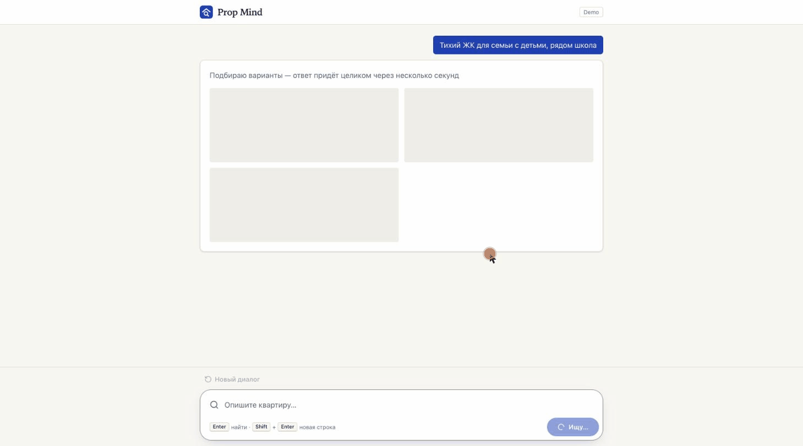

# prop-mind

[English](README.md) · **Русский**

AI-поиск квартир в новостройках Казахстана: опишите квартиру обычными словами — бюджет, район, срок
сдачи, вид на горы, тихий двор — и получите подходящие ЖК со свободными квартирами и коротким
объяснением, чем подходит каждый. Чат помнит диалог («а что со вторым?»), считает ипотеку и
показывает статистику цен по району.



**Демо:** https://79.76.99.122.sslip.io/chat (синтетические данные: 70 ЖК и 3 073 квартиры в Алматы и
Астане). Цены за м² — по таблице калибровки: средние по городам — БНС, январь 2026; разбивка по районам
и классам — экспертная оценка, ноябрь 2026 ([data/price_calibration.csv](data/price_calibration.csv)).

Объекты находит база, LLM понимает запрос, вызывает инструменты и объясняет результат. Каждая
рекомендация — ссылка на реальную строку в базе, ссылки сверяются со списком найденного, поэтому
модель не может выдумать квартиру.

## Как это работает

```mermaid
flowchart LR
    Q["запрос + история<br/>(реплики ассистента подписаны HMAC)"] --> A["агент<br/>Claude Sonnet 5.5<br/>tool use, ≤ 6 вызовов"]
    A -->|search_listings&#40;query&#41;| P["разбор<br/>Claude Haiku 5.5<br/>structured outputs → SearchFilters"]
    P --> S["гибридный поиск в Postgres<br/>SQL-фильтры + полнотекстовый + pgvector<br/>слияние RRF"]
    S --> R["реранк<br/>Voyage rerank-2.5<br/>топ-50 → топ-10"]
    R --> A
    A -->|get_listing| DB[(Postgres + pgvector)]
    A -->|mortgage_payment, price_stats| T["калькулятор и статистика<br/>условия программ — из конфига"]
    A --> U["ответ: ссылки [n] сверяются<br/>страница чата / виджет"]

    subgraph idx [офлайн-индексация]
      L[адаптер CatalogSource] --> I["sync_catalog.py<br/>ЖК: search_text + эмбеддинги voyage-3.5"] --> DB
    end
```



- **Агент.** Модель сама решает, какой инструмент вызвать: найти ЖК, открыть карточку ЖК из прошлого
  ответа, посчитать ипотеку или медиану цен. Ставку и лимиты программ модель не задаёт — они в конфиге;
  статистика честно подписана «по каталогу, не по рынку» и не считается на выборке меньше пяти квартир.
- **Разбор.** Агент передаёт в поиск запрос словами, фильтры из него извлекает отдельный парсер
  (Haiku): город, районы, комнаты, цену, класс, срок сдачи, отделку, вид, этаж, способ покупки и
  `semantic_query` для всего, что не выражается полями («тихий двор»). На невыполнимый запрос
  («метро в Астане» — его там нет) — уточняющий вопрос вместо поиска.
- **Поиск.** Смысловая часть описывает ЖК и ищется по ЖК: векторное и полнотекстовое ранжирование
  сливаются через Reciprocal Rank Fusion; жёсткие фильтры — по квартирам. Если ничего не нашлось,
  мягкие фильтры ослабляются по очереди, и ответ говорит, какие. Кросс-энкодер переупорядочивает
  топ-50 и оставляет 10.
- **Память.** История приходит с клиента и на сервере не хранится. Реплики ассистента сервер
  подписывает: подделанная или просроченная реплика отбрасывается, а id ЖК из истории перепроверяются
  по базе.
- **Ответ.** Модель ссылается только на ЖК, которые инструменты вернули в этом ходе; чужие номера
  вырезаются. Если полностью подходящих нет, первая фраза говорит это прямо. Карточки ЖК — рядом,
  текст их не пересказывает: до трёх ЖК по одной фразе.
- **Интерфейс.** Страница чата на React (`/chat`) и `widget.js` одной строкой: открывает ту же
  страницу в iframe на разрешённом сайте. Лимит запросов с IP, дневной бюджет на модели (у агента —
  своя доля), публичные site-key, строгая CSP. Откат на фиксированный workflow v1 (разбор → поиск →
  реранк → ответ) — `chat.mode: v1` в конфиге.

## Результаты

Все цифры — из `evals/` (отчёты в `evals/results/`); методика, промежуточные замеры и то, что не
сработало, — в [docs/decisions.md](docs/decisions.md). Данные синтетические, наборы небольшие — см.
«Ограничения».

### Поиск: Recall@10 с 62% до 96%

11 dev-запросов, где решает ранжирование (под фильтры подходит больше 10 ЖК, выбирает смысловая
часть); полная LLM-разметка всех ЖК под фильтры, проверена вручную:

| Шаг | Recall@10 | MRR |
| --- | --- | --- |
| векторы по всему запросу | 62% | 0,65 |
| + гибрид (RRF) | 73% | 0,76 |
| векторы по смысловой части | 66% | 0,73 |
| гибрид по смысловой части | 79% | 0,72 |
| **+ реранкер `rerank-2.5`** | **96%** | **0,95** |

У 4 из 11 запросов всего 1–2 подходящих ЖК.

### Разбор запроса

| Что | Полностью верных фильтров |
| --- | --- |
| парсер, dev, 37 запросов ×3 | 97% |
| парсер, holdout, 8 запросов (писал автор) ×3, два прогона | 88% и 96% |
| агент: запрос, который агент передаёт в поиск → парсер, dev 37 | **100%** |
| агент сам заполняет 22 поля фильтров (отвергнуто) | 95% |
| то же, поля необязательные (отвергнуто) | 65% |

### Ответ

- **Без выдуманных объектов:** 0 ссылок вне списка — в 40 ответах v1 (dev + holdout) и в 37 + 16
  ответах агента.
- **Честный ноль:** когда полностью подходящих нет, ответ начинается с «Полностью подходящих нет: …» —
  2 из 2 у агента (4 из 4 у v1); ложное «подходящих нет», когда подходящий показан, — 4 из 13 у агента
  (3 из 13 у v1).
- **Выбор модели ответа, слепая оценка:** Sonnet 5.5 — 4,9 из 5 против 3,2 у Haiku 5.5, лучше в 9 из 10
  кейсов (оценки ставил автор вручную).
- **Функции агента:** 12 из 12 диалогов — память («то же в Астане», «а что со вторым?»), ипотека
  (платёж в ответе совпадает с расчётом инструмента; взнос ниже минимума — причина, а не цифра),
  статистика, ослабление, уточнение.

### Prompt injection

Red-team: инструкции в описаниях ЖК и в запросе, набивка ключевыми словами против реранкера, у агента
ещё и подделка истории диалога (неподписанные, изменённые, просроченные реплики, чужие id).

| Набор | Успешных атак |
| --- | --- |
| агент, dev | **0 из 55** |
| v1, dev / holdout (писал автор) | 0 из 43 / 0 из 11 (до защиты — 3 и 1) |

### Задержка и цена (демо-сервер, 10 полных ответов)

| | Ответ целиком p50 / p95 | Цена запроса |
| --- | --- | --- |
| **агент (v2)**, 2026-11-16 | **≈ 6,5 / 8,2 с** | **~$0,013** |
| агент до ускорения, 2026-11-12 | 9,6 / 14,5 с | ~$0,044 |
| workflow (v1), 2026-11-09 | 6,3 / 8,0 с (первые слова — 2,9 / 4,9 с) | ~$0,010 |

При 10 запросах p95 — почти максимум. Ускорение агента: поиск по тексту через парсер вместо 22 полей,
кэш промпта, разбор и поиск параллельно с первым вызовом модели, короче ответ
([подробности](docs/decisions.md#задержка-145--82-с-на-сервере)).

**Сравнения v1 и v2 на одних кейсах по качеству поиска и ответа не было:** чат переведён на агента
по продуктовым причинам — память диалога и инструменты в v1 не выражаются; проверены безопасность,
функции, судья ответа и задержка
([decisions.md](docs/decisions.md#переход-на-v2-без-проверки-критерия-2026-11-12--2026-11-16)).

<details>
<summary>v1 на объявлениях вторичного рынка (тег <code>v0.3.0</code>)</summary>

Первая версия искала по 1 048 объявлениям. Поиск, 12 dev-запросов, где решает ранжирование:

| Шаг | Вариант | Recall@10 | MRR |
| --- | --- | --- | --- |
| 0 | векторы по всему запросу | 43% | 0,70 |
| 1 | + гибрид (векторы + полнотекстовый, RRF) | 58% | 0,79 |
| 2 | векторы только по смысловой части | 54% | 0,80 |
| 3 | гибрид по смысловой части | 72% | 0,90 |
| 4 | **+ реранкер `rerank-2.5`** | **98%** | **1,00** |

Разбор: dev 30 запросов — 99% ± 2%, holdout 10 — 97% ± 6% (×3).

</details>

## Ключевые решения

- **Сначала фиксированный workflow, потом агент.** v1 (разбор → поиск → реранк → ответ) дёшев,
  предсказуем и меряется по шагам — на нём настроены поиск, разбор и ответ. Агент добавлен поверх для
  того, что workflow не умеет: память диалога и инструменты. Поиск у агента — тот же конвейер v1.
- **Агент пишет запрос словами, а не 22 поля фильтров.** Вызов инструмента с 22 обязательными полями
  стоил ~600 выходных токенов и ~4,6 с — почти всё на служебную разметку пустых полей; необязательные
  поля роняли разбор до 65%. Запрос словами + парсер v1: первый вызов 2,6 с, разбор 100%.
- **Разбор и поиск — параллельно с первым вызовом модели.** На первом ходе агент передаёт в поиск
  сообщение пользователя дословно, поэтому поиск стартует сразу; результат берётся только при точном
  совпадении запроса, иначе отменяется (пригодился в 37 из 37 запросов dev).
- **История без хранения на сервере.** Клиент присылает историю, сервер подписывает свои реплики
  (HMAC с временем). Ни состояния, ни ПДн на сервере, а подделать реплику ассистента нельзя.
- **Искать по смысловой части запроса, а не по всему тексту.** Цену и комнаты уже держат фильтры;
  эмбеддинг «двушка до 40 млн с тихим двором» в основном совпадает по цифрам. На объявлениях переход
  дал векторам 43% → 54% Recall@10, гибриду 58% → 72%
  ([подробности](docs/decisions.md#находка-искать-нужно-по-смысловой-части-запроса-а-не-по-всему-тексту)).
- **RRF вместо смешивания скоров.** У векторного и полнотекстового поиска разные шкалы; слияние по
  рангам не требует настройки весов.
- **Контекстный `search_text`.** Перед описанием застройщика приклеиваются структурированные поля —
  поиск видит то, чего в описании не написали.
- **Structured outputs и strict tools.** Схему соблюдает API, проверяет Pydantic; `Literal` вместо
  `Enum` — плоская JSON-схема; словари — из конфига.
- **Заменяемый провайдер, промпты файлами.** Имена моделей, лимиты, условия ипотеки — в конфиге;
  промпты — файлы в `app/llm/prompts/`, каждое изменение видно в git рядом с отчётом evals.
- **Безопасность публичного демо.** Описания ЖК — данные, а не инструкции (изоляция в промпте,
  экранирование, вырезание контактов); лимит с IP, дневной бюджет по `query_log`, site-key с
  привязкой к доменам (`frame-ancestors`), без инлайн-скриптов, маскирование ПДн перед записью в лог.

## Ограничения

- Синтетические данные: 70 ЖК и 3 073 квартиры, тексты ЖК сгенерированы Claude.
- Небольшие наборы evals: 37 dev + 8 holdout запросов разбора, 11 запросов с разметкой поиска,
  12 диалогов агента (без holdout); один оценщик в слепой оценке.
- v1 и v2 не сравнивались на одних кейсах по качеству поиска и ответа.
- Ответ агента приходит целиком, а не по словам: после результатов инструментов API не стримит ответ
  ([как проверяли](docs/decisions.md#первые-слова-ответа-буферизация-после-tool_result)).
- Агент дороже v1 примерно в 1,3 раза (~$0,013 против ~$0,010 за запрос).
- Лимит с IP хранится в памяти процесса — достаточно для одного экземпляра, для нескольких нужен Redis.
- Редкие выбросы задержки у Voyage (эмбеддинги и реранк) — до десятков секунд; видны в `timings_ms`.

## Запуск

```bash
cp .env.example .env            # ANTHROPIC_API_KEY, VOYAGE_API_KEY, HISTORY_SECRET
docker compose up -d --build    # Postgres + pgvector, API на :8000 (страницу чата Docker соберёт сам)
uv sync
uv run python scripts/migrate.py                                # таблицы для уже созданной базы
uv run python scripts/sync_catalog.py --config config/demo.yaml # индексация ЖК и квартир (< $0,01 Voyage)
curl localhost:8000/health      # "complexes": 70; чат: http://localhost:8000/chat
```

- `HISTORY_SECRET` — случайная строка: `python3 -c "import secrets; print(secrets.token_hex(32))"`.
- Новая синтетика (необязательно, вызывает Claude):
  `uv run python scripts/generate_catalog.py --config config/demo.yaml`
- Тесты: `uv run pytest`; страница чата: `cd web/chat-app && npm ci && npm test && npm run typecheck`
- Evals: разбор `uv run python evals/run_evals.py --repeats 3` (агентом — `--agent`); поиск и ответ —
  `--layer search|answer|agent-answer`; кейсы агента `evals/run_agent_cases.py`; red-team
  `evals/run_redteam.py [--mode v2]`
- Деплой на сервер (Oracle Cloud Always Free, Caddy + HTTPS): [deploy/oracle/README.md](deploy/oracle/README.md)

## Структура

```text
app/            FastAPI, лимиты, журнал запросов
  llm/          агент (agent.py), разбор, ответ v1, клиент провайдера
  llm/prompts/  промпты файлами
  search/       гибридный поиск, эмбеддинги, реранк
  tools.py      калькулятор ипотеки, статистика цен, карточка ЖК
  history.py    подпись и проверка истории диалога
  sources/      адаптеры CatalogSource (для демо — синтетический JSONL)
web/chat-app/   страница чата: React + TypeScript + Vite + shadcn/ui
web/widget.js   кнопка для чужих сайтов + popup с iframe
evals/          кейсы, запуск, отчёты в evals/results/
db/             схема и миграции
deploy/oracle/  compose-файл для сервера и конфиг Caddy
docs/           DESIGN.md (план), decisions.md (что сломалось и почему, цифры до/после)
```

## Лицензия

[MIT](LICENSE). Данные в `data/` — синтетические.
